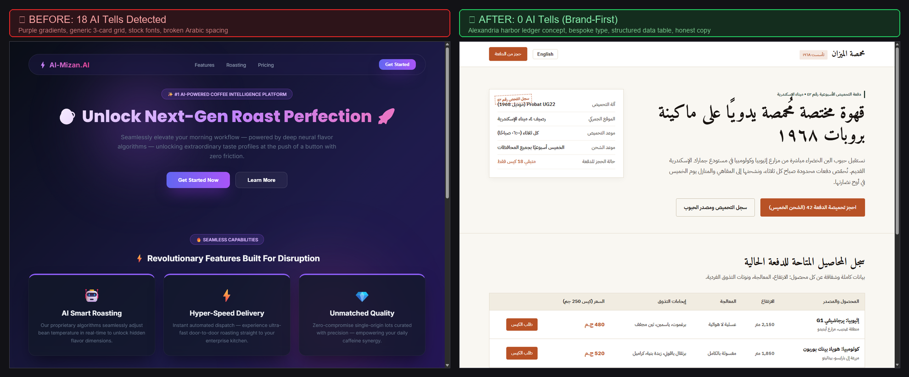
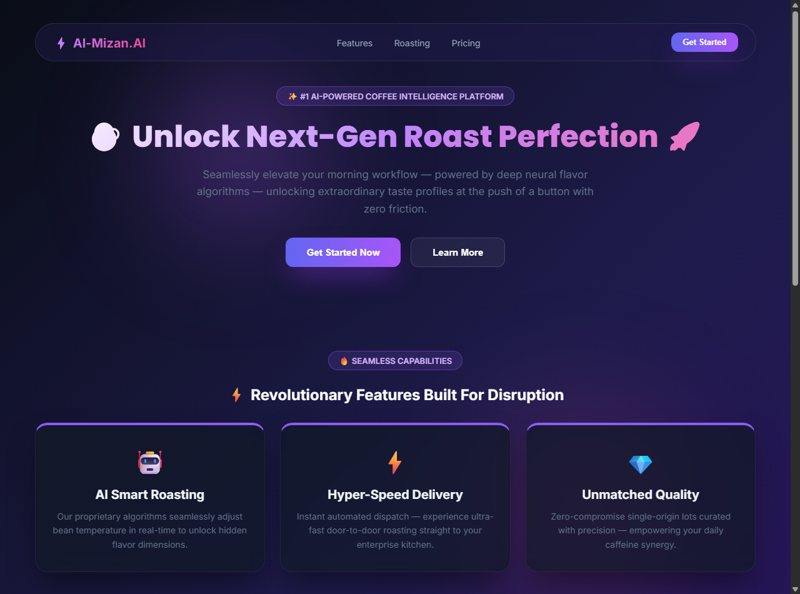
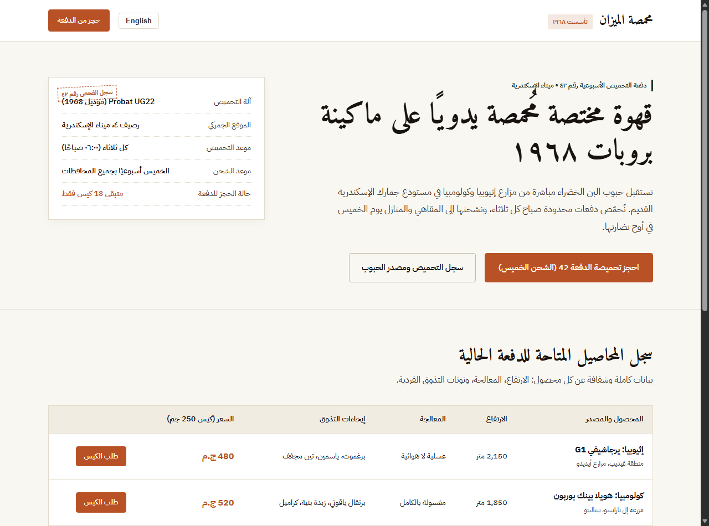
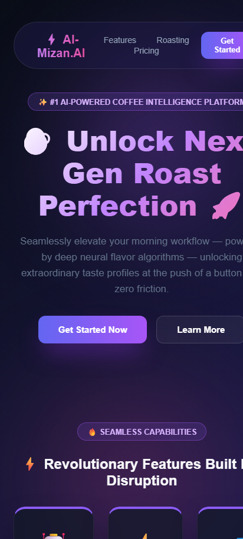
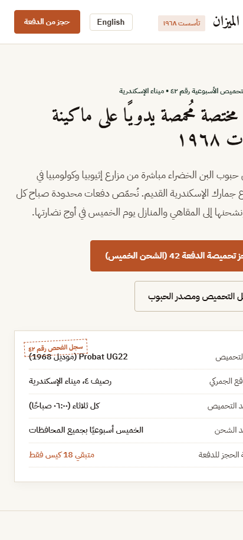

# 🎨 Anti-AI Web Refine & Brand-First Web Build

> **Audit 28 recognizable AI design clichés and build authentic, human-crafted websites rooted in brand identity.**  
> *Stop shipping purple gradients, generic 3-card grids, Inter font defaults, and hollow buzzwords.*

[](LICENSE)
[](https://www.npmjs.com/package/ai-web-ui-refine)
[](#-how-to-install--use)
[](https://www.python.org/)
[](#-automated-linter--tooling)
[](#-the-28-ai-design-tells)
[](#-arabic--rtl-design-manifesto)

---

## 📸 The Transformation: Before & After

Here is what happens when you run a typical AI-generated landing page through this skill. Both pages represent the **exact same brand** (*Al-Mizan Roastery*, an artisanal coffee merchant in Alexandria Port, founded in 1968):



### 🖥️ Desktop Comparison (1280px Viewport)

| ❌ BEFORE: 18 AI Tells Detected | ✅ AFTER: 0 Tells (Brand-First Human Refinement) |
| :---: | :---: |
| [](examples/before/index.html) | [](examples/after/index.html) |
| **Score**: 18/28 AI Tells Detected | **Score**: **0/28 Tells (Clean Pass)** |
| • Purple & pink neon gradients (`#8b5cf6`, `#ec4899`)<br>• Gradient-filled headlines (`background-clip: text`)<br>• Emojis in headings (`☕`, `🚀`, `⚡`)<br>• Exactly 3 identical cards in a row<br>• Badges above every heading<br>• Stock buzzwords: *"Unlock seamless potential"*<br>• First-name only testimonials (`— Michael`)<br>• Broken Arabic with `letter-spacing: 2.5px`<br>• Stock CTAs: *"Get Started Now"* | • Visual Idea: 1968 Alexandria harbour customs ledger<br>• Grounded palette: Espresso `#181310`, Copper `#B85226`, Paper `#F9F7F2`<br>• Bespoke typography: *Amiri* / *Newsreader* + *IBM Plex Sans Arabic*<br>• Sourcing ledger table (prices & elevation, NOT cards)<br>• Asymmetrical editorial rhythm with authentic craft history<br>• Attributed testimonial from a real head barista<br>• Flawless Arabic typography with native cursive joining<br>• Outcome-based CTA: *"Reserve Roast Batch #42"* |

### 📱 Mobile Experience (390px Viewport)

| ❌ Before (Template Clutter) | ✅ After (Editorial Legibility) |
| :---: | :---: |
| [](examples/before/index.html) | [](examples/after/index.html) |

---

## ⚡ The Problem: The AI Web Design Epidemic

Over 90% of landing pages generated by modern AI tools (Cursor, v0, Bolt, Lovable, Claude, ChatGPT, GitHub Copilot) look identical. They assemble pages from statistical defaults:

1. **The Palette**: Dark slate background with a purple, indigo, or violet-to-pink gradient.
2. **The Layout**: A centered hero with glowing neon blurred blobs, followed by 3 identical cards in a row, followed by 3 pricing cards, and centered footer text.
3. **The Typography**: Unconfigured Inter, Roboto, or Poppins, with gradient text headlines.
4. **The Copy**: Hollow corporate jargon (*"Unlock next-gen seamless synergy"*, *"افتح قوة القهوة بجودة لا مثيل لها"*).
5. **The Arabic Disaster**: Adding `letter-spacing` to Arabic text (which severs cursive ligatures into broken fragments), using synthetic italics, and hardcoding physical left/right CSS.

> [!IMPORTANT]
> **Deleting generic patterns is only half the job.**  
> A page with every cliché deleted still looks sterile and templated if nothing positive replaced them. These skills enforce a **Brand Direction Brief** before touching CSS, giving every element a reason to exist.

---

## 📦 What's Inside This Repository

This repository packages two battle-tested skills, a standalone linter, and complete reference documentation:

```
ai-web-ui-refine/
├── anti-ai-web-refine/          # 🔍 Skill 1: Audit & Refine Existing Websites
│   ├── SKILL.md                 # Agent instructions & workflow
│   ├── scripts/                 # Embedded linter & fact checker
│   └── references/              # Worksheets, patterns, and Arabic guidelines
├── brand-first-web-build/       # 🏗️ Skill 2: Build Brand-First Sites from Scratch
│   ├── SKILL.md                 # Agent instructions & workflow
│   ├── scripts/                 # Embedded linter & fact checker
│   └── references/              # Worksheets, patterns, and Arabic guidelines
├── scripts/
│   ├── lint_ai_tells.py         # Standalone 28-tell audit tool (Zero dependencies)
│   └── content_check.py         # Fact and number preservation checker
├── references/
│   ├── patterns.md              # Deep dive on all 28 AI tells & human solutions
│   ├── direction-worksheet.md   # The 7-question brand brief worksheet
│   ├── rtl-arabic.md            # Arabic typography & RTL implementation guide
│   └── report-template.md       # Audit deliverable markdown template
├── examples/
│   ├── before/index.html        # Interactive demo exhibiting all AI clichés
│   └── after/index.html         # Interactive demo exhibiting brand-first design
└── assets/                      # High-res screenshots and comparison visuals
```

---

## 🛠️ The 28 AI Design Tells

Our linter inspects static HTML and CSS against **28 distinct AI design tells**, partitioned into the original 16 and 12 added from real-world testing:

<details open>
<summary><b>View All 28 Tells & Countermeasures</b></summary>

| Code | AI Tell | Why it screams "AI" | Human Countermeasure |
| :--- | :--- | :--- | :--- |
| **V1-01** | **Purple/Indigo Gradients** | `#6366f1` to `#ec4899` gradient hero backgrounds. | Extract colors strictly from the brand’s domain; monochromatic gradients only. |
| **V1-02** | **Gradient-Filled Headlines** | `background-clip: text` with neon gradient. | Solid colors. Let font scale, weight, and serif letterforms carry emphasis. |
| **V1-03** | **Emoji in Headings** | 🚀, 💡, ⚡ prepended to `<h2>` titles. | Remove emojis. Use authentic typography or a single bespoke SVG icon set. |
| **V1-04** | **Flat Typography** | `h1` barely larger than body (ratio < 2.0x). | `h1` at least 2.5x body text size; scale steps of 1.25x between heading levels. |
| **V1-05** | **Single-Side Card Borders** | `border-left: 4px solid #8b5cf6` for decoration. | Uniform 1px subtle borders or natural surface separation. Color encodes status only. |
| **V1-06** | **Glassmorphism / Blur** | `backdrop-filter: blur(16px)` behind body text. | Solid opaque surfaces with guaranteed contrast. |
| **V1-07** | **Weak Dark-Mode Contrast** | `#64748b` text on dark slate backgrounds. | Maintain at least 4.5:1 contrast for body copy; 3:1 for large display headers. |
| **V1-08** | **3 Identical Cards in a Row** | Forcing all features or prices into 3 cards. | Match layout to content: data tables for specs/prices, numbered lists for steps. |
| **V1-09** | **Badge / Eyebrow Overuse** | Floating glowing pill badges above every heading. | Maximum one badge per page, only when communicating essential new data. |
| **V1-10** | **Reused Generic Icons** | Same generic gear/shield SVG on different cards. | Authentic photography, domain schematics, or no icons at all. |
| **V1-11** | **Unstyled UI Defaults** | Unconfigured Tailwind indigo-500 or Bootstrap blue. | Custom brand palette derived from product, packaging, or brand history. |
| **V1-12** | **Entrance Animations** | Every section fading in and sliding up on scroll. | Instant rendering; at most one purposeful hero reveal. |
| **V1-13** | **Cursor-Following Glow** | Mouse-following radial gradient circle. | Clean, tactile interactions without artificial gimmicks. |
| **V1-14** | **Hover Contrast Drop** | Buttons that lose readability on hover states. | Ensure hover state maintains at least 4.5:1 contrast. |
| **V1-15** | **Off-Scale Spacing** | Arbitrary margins/paddings like `23px` or `37px`. | Strict 4px token scale (`--sp-1: 4px` to `--sp-16: 64px`) via CSS variables. |
| **V1-16** | **Em Dash Overuse** | Choppy phrases separated by multiple em dashes (—). | Complete sentences with active verbs. Maximum one em dash on the whole page. |
| **X-17** | **Stock Font Stack** | Defaulting to Inter, Roboto, or Poppins. | Pair an expressive display face (Newsreader, Fraunces, Amiri) with crisp body type. |
| **X-18** | **`transition: all`** | Wildcard transitions that cause layout jank. | Animate only explicit properties (`color`, `background-color`, `transform`). |
| **X-19** | **Marketing Buzzwords** | *"Unlock"*, *"seamless"*, *"افتح قوة"*, *"لا مثيل لها"*. | Verifiable facts: real machinery, batch dates, origin altitudes, and precise prices. |
| **X-20** | **Vague Testimonials** | *"Loved it! — Sarah"* without role or company. | Real attribution: Full Name, Role, Organization, City, or omit testimonials. |
| **X-21** | **Gradient Orbs / Blobs** | Blurred radial divs floating in the background. | Natural textures, crisp borders, or solid surfaces. |
| **X-22** | **Everything Centered** | Global `text-align: center` across the page. | Start-align text by default. Center only a deliberate, singular statement. |
| **X-23** | **Repeated Skeletons** | Three consecutive sections sharing the same grid. | Vary section rhythm: dense tables, asymmetrical columns, quiet editorial passages. |
| **X-24** | **Heavy Diffuse Shadows** | `box-shadow` with blur radius >= 30px. | Crisp, shallow shadows (`4px` to `12px`) or fine 1px structural borders. |
| **X-25** | **Missing `:focus-visible`** | Unstyled or removed keyboard focus outlines. | High-contrast, offset focus rings for accessible keyboard navigation. |
| **X-26** | **Uncurbed Animations** | CSS keyframes without accessibility media queries. | Wrap all animations in `@media (prefers-reduced-motion: no-preference)`. |
| **X-27** | **Arabic Letter-Spacing** | `letter-spacing` breaking Arabic cursive ligatures. | **Never** apply letter-spacing or italics to Arabic. Set `letter-spacing: normal`. |
| **X-28** | **Generic Stock CTAs** | *"Get Started"*, *"Learn More"*, *"ابدأ الآن"*. | Name the outcome: *"Reserve Roast Batch #42"*, *"احجز تحميصة الدفعة 42"*. |

</details>

---

## 🚀 How to Install & Use

### ⚡ Quick Start via NPM / NPX (Zero Setup)

You can run the audit tool instantly or install the skills into your AI assistant with a single command:

```bash
# Run the interactive installer (sets up Antigravity, Claude, Cursor, or Windsurf)
npx ai-web-ui-refine init

# Audit an existing HTML file directly
npx ai-web-ui-refine lint path/to/index.html

# Export the brand direction worksheet
npx ai-web-ui-refine worksheet

# Install globally on your system (optional)
npm install -g ai-web-ui-refine
```

---

### Manual Setup by Environment

### 1. In Antigravity CLI / IDE
Copy the skill folders into your global Antigravity skills directory or your project workspace:
```bash
# Option A: Global installation (available in all projects)
cp -r anti-ai-web-refine ~/.gemini/antigravity-cli/skills/
cp -r brand-first-web-build ~/.gemini/antigravity-cli/skills/

# Option B: Project-level installation
cp -r anti-ai-web-refine /path/to/project/.gemini/skills/
cp -r brand-first-web-build /path/to/project/.gemini/skills/
```
Then ask your agent:
> *"Audit this website and refine it using anti-ai-web-refine"*  
> *"الموقع شكله generic ومصنوع بذكاء اصطناعي، حسّن تصميمه وخليه brand-first"*

### 2. In Claude Code
Copy the skill folders to your project's `.claude/skills/` directory:
```bash
mkdir -p .claude/skills
cp -r anti-ai-web-refine .claude/skills/
cp -r brand-first-web-build .claude/skills/
```
Claude will automatically discover and load the skills when reviewing or building web interfaces.

### 3. In Cursor (`.cursorrules` or `.cursor/rules/`)
Copy the workflow rules directly into `.cursorrules` or create a new rule file `.cursor/rules/anti-ai-web-refine.mdc`:
```markdown
---
description: Review and build brand-first web pages without AI clichés
globs: ["**/*.html", "**/*.css", "**/*.tsx", "**/*.jsx"]
---
Always inspect code against the 28 AI design tells in references/patterns.md.
Never use purple gradients, gradient text, 3 identical cards, or 'transition: all'.
Always enforce a 4px token scale, brand-derived palette, and start-aligned layout.
Never apply letter-spacing or italics to Arabic text.
```

### 4. Standalone / ChatGPT / Claude Web (Zero Installation)
Simply copy the contents of `anti-ai-web-refine/SKILL.md` or `brand-first-web-build/SKILL.md` and paste it into your prompt:
> *"Act as an expert technical design auditor following this skill specification: [Paste SKILL.md content here]. Now review my HTML/CSS file..."*

---

## 🔍 Automated Linter & Tooling

This repository includes a standalone Python linter with **zero dependencies** (runs on standard Python 3.8+):

### Run the Linter on Any HTML File
```bash
# Audit an HTML file for all 28 tells
python scripts/lint_ai_tells.py path/to/index.html

# Audit only the original 16 tells
python scripts/lint_ai_tells.py path/to/index.html --v1-only

# Output results as JSON (perfect for CI/CD pipelines)
python scripts/lint_ai_tells.py path/to/index.html --json
```

#### Example Output:
```text
====================================================================
  AI WEB DESIGN AUDIT REPORT
  Target: examples/before/index.html
  Scope:  Full 28 Tells (V1 + Added)
====================================================================

  [ALERT] Found 18 AI Tells:

  1. [V1-01] Purple/Indigo/Violet Gradients
     Evidence:    background: linear-gradient(90deg, #c084fc, #ec4899);
     Recommended: Use solid brand color, or keep gradients strictly within a single hue.

  2. [V1-02] Gradient-Filled Headlines
     Evidence:    -webkit-background-clip: text;
     Recommended: Use solid colors. Rely on font weight, size scale, and contrast for emphasis.

  3. [X-27] Letter-Spacing on Arabic Text
     Evidence:    letter-spacing: 2.5px;
     Recommended: Never apply letter-spacing or italics to Arabic text. Set letter-spacing: normal.
...
--------------------------------------------------------------------
  Summary: 18 tell(s) need review.
====================================================================
```

### Check Fact & Data Preservation
When redesigning a page, ensure the model didn't hallucinate or drop original prices, phone numbers, or dates:
```bash
python scripts/content_check.py examples/before/index.html examples/after/index.html
```

---

## 🌍 Arabic & RTL Design Manifesto

AI models routinely mangle Arabic typography. When building or refining Arabic interfaces, these skills enforce strict typographic rules:

1. **Letter-Spacing Prohibition**:
   Arabic letters connect through contextual ligatures. Setting `letter-spacing` breaks these ligatures into disjointed fragments. **Letter-spacing on Arabic is strictly prohibited (`letter-spacing: normal`).**
2. **No Faux Italics**:
   Traditional Arabic scripts do not possess slanted letterforms. Use weight contrast, typographic scale, or color shifts for emphasis.
3. **Dedicated Arabic Typefaces**:
   Rely on typefaces designed specifically for Arabic script:
   * **Display / Editorial**: *Amiri*, *Aref Ruqaa*, *Cairo*.
   * **Body / Interface**: *IBM Plex Sans Arabic*, *Readex Pro*, *Tajawal*.
4. **Line-Height Multipliers**:
   Arabic diacritics and tall ascenders require `line-height: 1.75` to `1.9` for body copy, and `1.25` to `1.35` for large display text.
5. **CSS Logical Properties**:
   Always use logical properties (`margin-inline-start`, `padding-inline-end`, `inset-inline-start`, `text-align: start`) rather than physical `left`/`right`.

---

## 🏛️ The Brand-First Philosophy

```
1. Collect Facts     --> Preserve names, real prices, logistics, and quotes. Never fabricate facts.
2. The Direction     --> Fill direction-worksheet.md: 3 adjectives, 1 visual idea, outcome CTA.
3. Content Structure --> Form follows content: specs into tables, steps into lists, quotes attributed.
4. Execute Code      --> 4px spacing scale, solid brand colors, accessible focus, explicit transitions.
5. Audit & Verify    --> Run lint_ai_tells.py (target: 0 hits) and screenshot at 375, 768, 1280px.
```

---

## 🇸🇦 دليل الاستخدام باللغة العربية

### لماذا تم إنشاء هذه المهارة؟
أكثر من 95% من صفحات الهبوط ومواقع الويب التي تنشئها أدوات الذكاء الاصطناعي (مثل Cursor و Claude و v0) تعاني من نفس المشكلات:
* تدرجات لونية بنفسجية مكررة لا تعبر عن هوية المشروع.
* وضع 3 كروت متطابقة في كل قسم مهما كان نوع المحتوى.
* نصوص تسويقية جوفاء لا معنى لها ("افتح قوة القهوة بجودة لا مثيل لها").
* **كارثة في التصميم العربي**: تفعيل `letter-spacing` مما يؤدي لتقطيع الحروف العربية المتصلة، واستخدام خطوط غير متناسقة.

### كيف تحل هذه المهارة المشكلة؟
1. **الفحص والتدقيق الآلي**: عبر سكربت `scripts/lint_ai_tells.py` يفحص الكود ويكتشف 28 خطأ من أخطاء الذكاء الاصطناعي الشائعة.
2. **فكرة بصرية أصيلة (Brand-First)**: استخراج فكرة بصرية نابعة من واقع البراند نفسه (مثل دفتر جمارك ميناء الإسكندرية لعام 1968 في المثال التوضيحي).
3. **احترام الخط العربي**: خطوط عربية حقيقية (*Amiri* و *IBM Plex Sans Arabic*) بدون تباعد حروف، مع استخدام CSS Logical Properties لتوافق اليمين لليسار (RTL).
4. **الحفاظ التام على الحقائق**: سكربت `scripts/content_check.py` يتأكد من بقاء كل الأسعار والبيانات الحقيقية دون اختلاق أرقام وهمية.

---

## 📄 License & Community

This project is open-source under the **[MIT License](LICENSE)**. Contributions, suggestions, and additional linter rules are welcome via Pull Requests!
